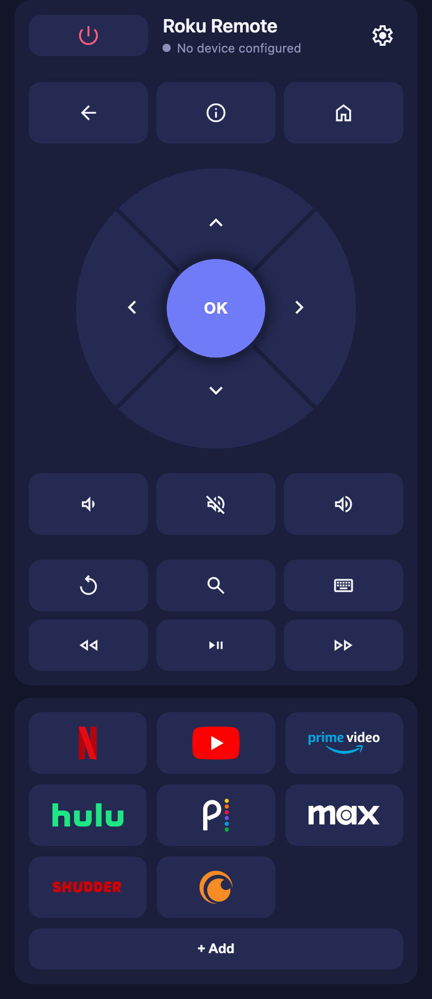

# Roku Remote

A small, installable web app (PWA) for controlling a Roku from your phone. At
home it talks straight to the Roku over Wi‑Fi. Away from home it can fall back
to Home Assistant. Settings live on your own server, so every phone in the
house shares the same devices and app shortcuts.

<p align="center">
  
</p>

## Features

- Circular D-pad with a generous OK button (the directions can't steal OK taps)
- Power, back, home, info, volume, mute, replay, rewind, play/pause, fast-forward
- Text entry and search, sent straight to the Roku
- One-tap shortcuts for apps and TV inputs, with real logos for common services
- Optional Home Assistant fallback when the Roku can't be reached directly
- Shared settings across phones, plus an offline cache on each phone
- Installs to the home screen and runs full screen, with no app store

## Before you start: what you'll need to fill in

This repo ships with **no devices or accounts configured**. You'll supply these
yourself, mostly through the app's ⚙️ Settings screen:

| What | Where to find it | Required? |
|---|---|---|
| **Your Roku's IP address** | On the Roku: Settings → Network → About. Or check your router's device list. Giving the Roku a reserved/static IP in your router is recommended. | Yes |
| **"Control by mobile apps" turned on** | On the Roku: Settings → System → Advanced system settings → Control by mobile apps → **Enabled**. Without this, Roku OS 14.1+ rejects commands. | Yes |
| **A web server with PHP** | Anything that runs PHP 7.4+ on your home network: a NAS, a Raspberry Pi, a spare computer. See [Hosting](#hosting). | Yes |
| **TV input IDs** (for HDMI shortcuts) | Usually `tvinput.hdmi1` to `tvinput.hdmi4`, or `tvinput.dtv` for the antenna/cable tuner. Add them with **+ Add**. | Optional |
| **App IDs** for apps not in the defaults | Visit `http://<your-roku-ip>:8060/query/apps` in a browser on the same network. It lists every installed app and its ID. | Optional |
| **Home Assistant URL, token and Roku entity ID** | See [Home Assistant fallback](#home-assistant-fallback-optional). | Optional |

The default app shortcuts (Netflix, YouTube, Prime Video, Hulu, Peacock, Max,
Shudder, Crunchyroll) use their standard Roku channel IDs. Long-press any tile to
edit or remove it.

## How it works

- **At home:** the app sends Roku's [External Control Protocol (ECP)](https://developer.roku.com/docs/developer-program/dev-tools/external-control-api.md)
  commands directly to the Roku, for example `POST http://<roku-ip>:8060/keypress/Home`.
  This only works when your phone and the Roku are on the same network.
- **Away from home:** if the direct call times out, the app retries through your
  Home Assistant Roku integration (`remote.send_command` /
  `media_player.select_source`), if you've set it up.
- **Shared settings:** on load, the app reads devices, app shortcuts and Home
  Assistant settings from `api.php`. It writes them back whenever you change
  something. `api.php` stores them in a `roku-remote-data/state.json` file one
  folder *above* the site folder, so the web server can never serve that file
  directly. If the server can't be reached, each phone falls back to its last
  cached copy.

## Hosting

The site must be served over plain **HTTP** on your local network. A page loaded
over HTTPS isn't allowed to call the Roku's HTTP address (browsers block mixed
content).

1. Copy every file in this repo into a folder on your web server, including `api.php`.
2. Serve that folder with PHP enabled.
3. Make sure the web server's user can create and write a folder named
   `roku-remote-data` **next to** the site folder (its parent directory). If it
   can't create one itself, create it manually and give the web server
   read/write access.
4. If your PHP setup uses `open_basedir`, it must allow that sibling folder too.

**Quick local test** (on a computer with PHP installed):

```bash
php -S 0.0.0.0:8787
```

Then open `http://<that-computer's-ip>:8787` on your phone. (`python3 -m http.server`
won't work for real use, because it can't run `api.php`. The app still loads, but
settings won't be shared between phones.)

<details>
<summary><strong>Example: Synology NAS with Web Station</strong></summary>

1. Package Center → install **Web Station** and a PHP package (PHP 8.x works).
2. Create a shared folder for the site and upload this repo's files into it.
3. Web Station → **Web Portal** → create a portal → **Native script language website**.
   Point it at your folder, choose a PHP profile, and use a port-based HTTP portal
   (not 80/443, not HTTPS).
4. In the PHP profile, leave `open_basedir` at its default (none) so `api.php`
   can reach the sibling `roku-remote-data` folder.
5. Give the `http` user read/write access to the folder that contains your site
   folder, or create `roku-remote-data` there yourself in File Station and grant
   access to it.

</details>

## Installing on each phone

1. Open your hosted URL in Safari (iOS) or Chrome (Android).
2. **iOS:** Share → *Add to Home Screen*. **Android:** ⋮ menu → *Install app*.
3. Open it from the home screen icon.
4. Tap ⚙️, add your Roku's name and IP address, and you're ready.

Do this once per phone. Devices and shortcuts sync between phones through your server.

## Home Assistant fallback (optional)

This lets the remote keep working when you're away from home, for example to turn
the TV off from bed when your phone has dropped Wi‑Fi.

1. Set up the [Roku integration](https://www.home-assistant.io/integrations/roku/)
   in Home Assistant.
2. In Home Assistant: your profile → Security → **Long-lived access tokens** → Create token.
3. In the app's Settings, fill in:
   - **Base URL:** how you reach Home Assistant, such as `https://yourname.ui.nabu.casa`
   - **Token:** the long-lived token
   - **Entity ID:** your Roku's `media_player.*` entity, from Settings →
     Devices & services → Entities

> **Security note:** the token is stored by `api.php` on your server and is only
> ever sent to the Home Assistant URL you enter. The app has no login of its own,
> so anyone on your home network who can reach `api.php` could read it. That's
> fine on a trusted home network, but **don't expose this site to the internet**
> without adding real authentication first.

## Known limitations

- **Power** sends Roku's `Power` key, which toggles standby on Roku TVs. Waking
  from deep standby can take several seconds. Streaming sticks without a built-in
  display don't have a true off state.
- **Private listening and voice search** use Roku's proprietary channels, not
  ECP, so they can't be replicated here.
- **App and input IDs** can vary by device and region. Use `/query/apps` (see
  above) to look up the exact IDs on your Roku.

## Credits

- Interface icons: [Material Symbols](https://fonts.google.com/icons) (Apache 2.0).
- Several app logos come from [Dashboard Icons](https://github.com/homarr-labs/dashboard-icons)
  (CC BY 4.0), some recolored for a dark background.
- All app and console logos are trademarks of their respective owners. This
  project isn't affiliated with or endorsed by Roku or any of them.

## License

The code is released under the [MIT License](LICENSE). The MIT License covers
this project's own code only, not the third-party logos and icons listed above,
which keep their own licenses and trademarks.
